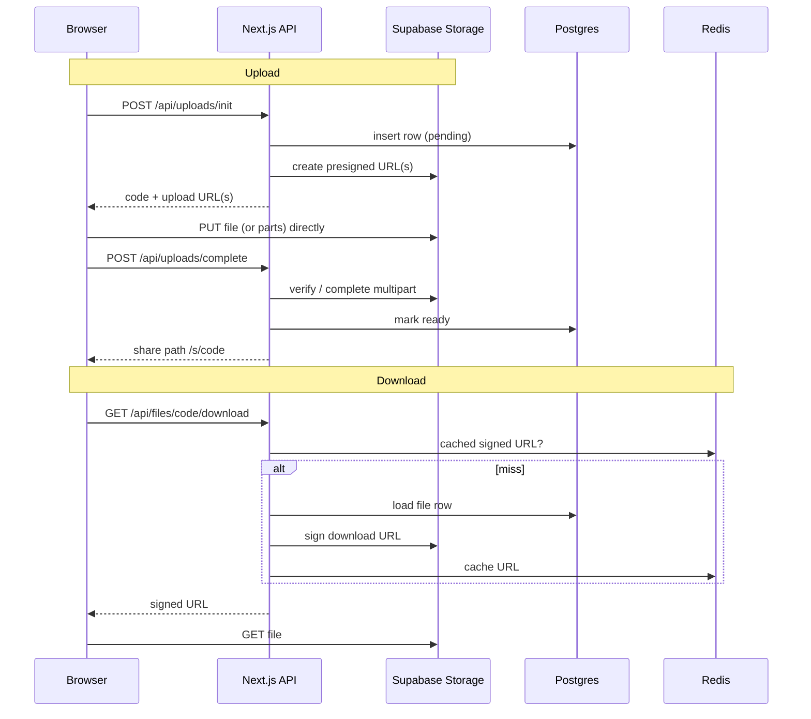

# AeroShare

Simple file sharing with short links. Drop a file, get a link, share it. No account needed.

## Features

- No login or sign-up.
- Drag-and-drop upload.
- 50 MB file limit (see [Limits & notes](#limits--notes)).
- Presigned upload: the browser sends the file straight to storage, not through the app server.
- Multipart upload for files larger than 5 MB (8 MB parts, 3 in parallel, retry with backoff).
- Download URLs are signed and cached in Redis.
- Base62 short links (8 characters), for example `/s/Ab3dE9xZ`.
- Per-IP rate limiting.
- Files expire after 1 day or 7 days, and a cleanup job removes them.
- Dark and light theme.

## Tech stack

| Area | Technology |
| --- | --- |
| Framework | Next.js 16 (App Router), React 19, TypeScript |
| UI | Tailwind CSS v4, shadcn/ui (Base UI), Sonner, next-themes |
| Storage | Supabase Storage (private bucket, S3-compatible API) |
| Database | Supabase Postgres |
| Cache and rate limit | Upstash Redis |
| Validation | zod |
| Tests | Vitest |
| Hosting and CI/CD | Vercel, GitHub Actions |

## How it works



More detail: [docs/architecture.md](docs/architecture.md).

## Quick start

Prerequisites: Node.js 24, npm, a Supabase project and an Upstash Redis database (see [docs/setup.md](docs/setup.md)).

```bash
npm install
cp .env.example .env     # then fill in the values
# apply the SQL files in supabase/migrations (see supabase/README.md)
npm run dev
```

Open http://localhost:3000.

Redis is optional for local work: without it, caching is skipped and rate limiting is off (fails open).

## Scripts

| Script | What it does |
| --- | --- |
| `npm run dev` | Start the dev server |
| `npm run build` | Production build |
| `npm run start` | Run the production build |
| `npm run lint` | ESLint |
| `npm run typecheck` | `next typegen` then `tsc --noEmit` |
| `npm test` | Unit tests (Vitest) |
| `npm run format` | Prettier |

## Project structure

The app follows an MVC-style layout inside Next.js.

```
src/
  app/                    Views (pages) and route handlers
    page.tsx              Home: upload
    s/[code]/             Share page: download
    api/
      uploads/{init,complete,abort}/route.ts
      files/[code]/route.ts            metadata
      files/[code]/download/route.ts   signed download URL
      cron/cleanup/route.ts            expiry cleanup
  components/             Views: upload, download, layout, theme, ui (shadcn)
  server/
    controllers/          Request logic: upload, download, cleanup
    models/               fileModel: the only code that touches the files table
    services/             Storage (S3 + signed URLs), cache, rate limit, Supabase client
  shared/contracts/       zod schemas, constants and error codes used by client and server
  lib/                    base62, env, errors, client uploader/downloader
supabase/migrations/      SQL: files table, RLS, private bucket
docs/                     Documentation
.github/workflows/        CI, preview, deploy, cleanup cron
```

## Documentation

- [Architecture](docs/architecture.md)
- [API reference](docs/api.md)
- [Setup guide](docs/setup.md)
- [CI/CD](docs/ci-cd.md)
- [Database notes](supabase/README.md)

## Limits & notes

- The limit is 50 MB because that is the global Storage cap on the Supabase Free plan.
- To allow larger files (for example 512 MB) you need a paid Supabase plan. Raise the global limit under Project Settings -> Storage -> "Upload file size limit", then update all three places:
  1. `MAX_FILE_SIZE` in `src/shared/contracts/constants.ts`
  2. the `size_bytes` check in `supabase/migrations/20261031000000_init_files.sql`
  3. the bucket `file_size_limit` in `supabase/migrations/20261031000100_storage_bucket.sql`
- Anyone who has a link can download the file until it expires. There is no password or account.
