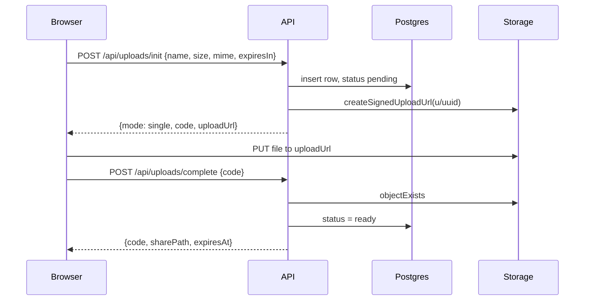
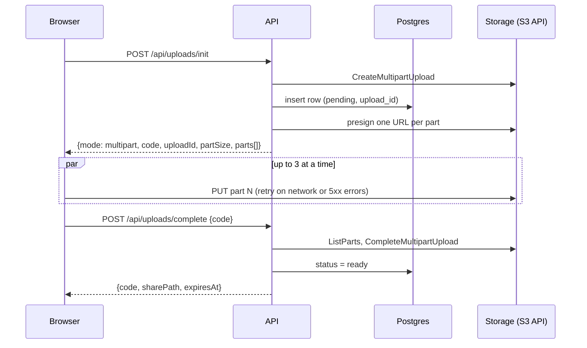
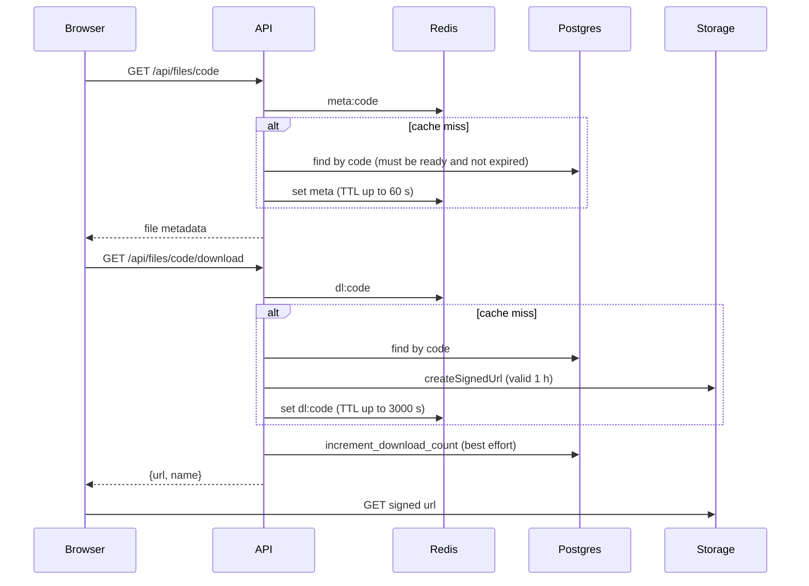
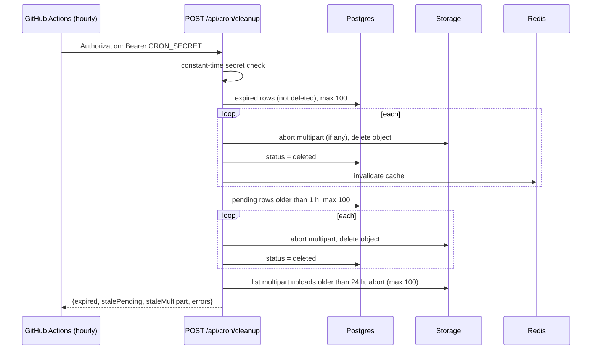
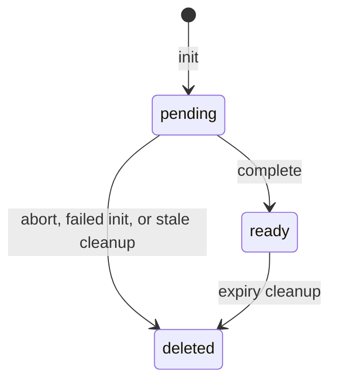

# Architecture

AeroShare is a single Next.js app. Browsers upload and download files directly to and from Supabase Storage. The app server only creates signed URLs and tracks file state in Postgres.

## MVC mapping

| Layer | Location | Role |
| --- | --- | --- |
| View | `src/app/**/page.tsx`, `src/components/**` | Pages and UI (upload card, download card, theme) |
| Routes | `src/app/api/**/route.ts` | Thin HTTP adapters: rate limit, call a controller, map errors to JSON |
| Controller | `src/server/controllers/*` | Request logic: `uploadController`, `downloadController`, `cleanupController` |
| Model | `src/server/models/fileModel.ts` | All reads and writes of the `files` table |
| Services | `src/server/services/*` | External systems: `storageService` (Supabase Storage + S3 API), `cacheService` (Redis), `rateLimitService`, `supabaseClient` |
| Shared | `src/shared/contracts/*` | zod schemas, constants and error codes shared by browser and server |
| Client logic | `src/lib/client/*` | `uploader.ts` (single and multipart upload), `downloader.ts` |

## Request flows

### Single upload (file up to 5 MB)

### Multipart upload (file larger than 5 MB)

The part size is 8 MB, so a 50 MB file has at most 7 parts. The server lists the uploaded parts itself, so the browser never needs to read the `ETag` header.

If the upload fails or is cancelled, the browser calls `POST /api/uploads/abort` on a best-effort basis. Abort only works on `pending` rows.

### Download with Redis cache

The cached download TTL (3000 s) is shorter than the signed URL lifetime (3600 s), and is also capped by the time left until the file expires.

### Cleanup and expiry

Expired files are also rejected at request time (`410 EXPIRED`), so a file stops being downloadable at its expiry even before the cleanup runs.

## Data model

Table `public.files`:

| Column | Type | Notes |
| --- | --- | --- |
| `id` | uuid | Primary key |
| `short_code` | text | Unique, 8-character Base62 code |
| `original_name` | text | |
| `size_bytes` | bigint | Check: > 0 and <= 52428800 |
| `mime_type` | text | |
| `storage_path` | text | `u/<uuid>` in the bucket |
| `upload_id` | text | Multipart upload id, cleared when done |
| `status` | text | `pending`, `ready` or `deleted` |
| `download_count` | int | Bumped by `increment_download_count()` |
| `created_at` | timestamptz | |
| `expires_at` | timestamptz | 1 day or 7 days after init |

Indexes: `files_expires_at_idx`, `files_status_created_at_idx`, plus the unique index on `short_code`.

Status lifecycle:

Rows are marked `deleted`, not removed. `markReady` only updates rows that are still `pending`, so an aborted upload cannot come back to life.

## Security model

- **No authentication.** The 8-character short code is the capability: whoever has the link can download the file until it expires. Codes are crypto-random Base62. The code space is large but the app does not claim the links are unguessable beyond that, so do not share sensitive files.
- **RLS deny-all.** Row Level Security is on for `files` with no policies, so the public anon key can read and write nothing. Short codes cannot be listed.
- **Service role on the server only.** `SUPABASE_SERVICE_ROLE_KEY` and the S3 keys are only read in server code. `increment_download_count()` is executable by `service_role` only.
- **Private bucket, signed URLs.** The `uploads` bucket is private and has no policies for `anon` or `authenticated`. Uploads use signed upload URLs or presigned part URLs; downloads use signed URLs that last 1 hour. Download signing sets the original file name.
- **Abort is limited.** `POST /api/uploads/abort` only works on `pending` uploads, so a ready file cannot be deleted by code alone.
- **Rate limits (per IP, sliding window of 1 minute)**, from `rateLimitService`:

  | Policy | Limit | Used by |
  | --- | --- | --- |
  | `init` | 10 | `POST /api/uploads/init` |
  | `complete` | 30 | `POST /api/uploads/complete` |
  | `abort` | 30 | `POST /api/uploads/abort` |
  | `download` | 60 | `GET /api/files/[code]/download` |
  | `metadata` | 120 | `GET /api/files/[code]` |

  The client IP comes from `x-forwarded-for` (first value) or `x-real-ip`.
- **Cron endpoint.** `POST /api/cron/cleanup` needs `Authorization: Bearer <CRON_SECRET>`. The comparison uses `timingSafeEqual`. If `CRON_SECRET` is not set, every request is rejected.
- **Input validation.** Request bodies are validated with the zod schemas in `src/shared/contracts`. The size limit is enforced in the client, the API and the database.

## Scalability notes

- The API is stateless and runs as serverless functions on Vercel, so it scales by adding instances.
- File bytes do not pass through the app server. The browser talks to Supabase Storage directly, which avoids serverless body-size and duration limits for uploads.
- Redis caches metadata (up to 60 s) and signed download URLs (up to 3000 s), which reduces database and signing work on popular links.
- Cleanup is batched (100 items per step per run) and runs hourly, so a large backlog is cleared over several runs.
- There is no long-running process, so no container orchestration such as Kubernetes is needed for this design.

## Trade-offs and limitations

- **Fail open.** If Redis is missing or errors, rate limiting is skipped and caching is bypassed. This keeps the app available, but it means limits are not enforced during a Redis outage.
- **Rate limit by IP.** Users behind a shared IP share a limit, and the limit depends on the proxy headers being correct.
- **Download counter is best effort.** If it fails, the download still works. The counter counts requests for a download URL, not completed downloads.
- **Signed URLs can be shared.** Once issued, a signed download URL works for its lifetime (up to 1 hour) for anyone who has it.
- **File size.** 50 MB because of the Supabase Free plan. See the README for how to raise it.
- **Browser upload to the S3 endpoint and CORS** were written down as a spike (`src/server/services/SPIKE_S3_CORS.md`), which states it was not verified against a live project in that branch. Test a real upload in your own environment. If the browser is blocked by CORS, the spike notes list fallbacks (TUS resumable upload).
- **No virus scanning, no per-file deletion by the uploader after completion, and no password protection.** These are not implemented.
